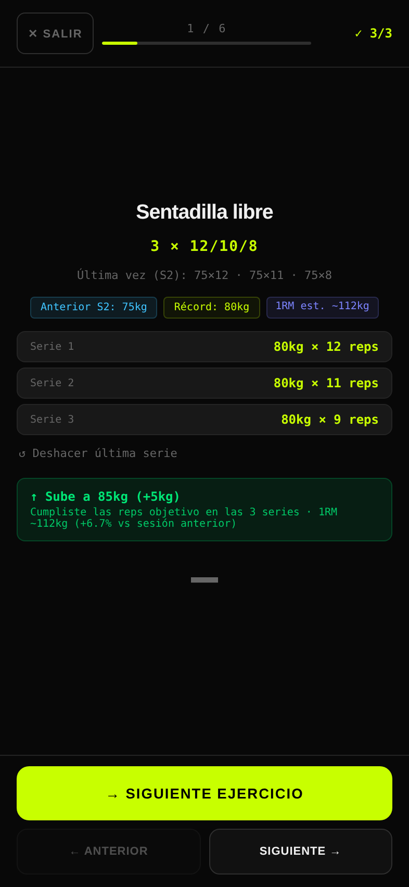
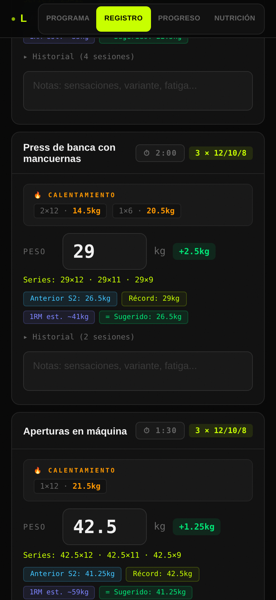
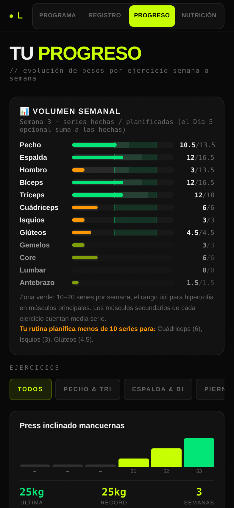

<div align="center">


# LIFTR

**Train smarter. Lift heavier.**
A mobile-first PWA to log strength & hypertrophy training, with automatic progression.

[**Live demo →**](https://liftr-7u9.pages.dev)


  

</div>

## Why

I wanted to log my gym sessions from my phone without paper notebooks or bloated fitness apps, and have the tool tell me **when to add weight** based on what I actually lifted. So I built it.

## Features

| | |
|---|---|
| 🏋️ **Training program** | 4-day split + 1 optional core day, free weights + calisthenics, per-exercise sets, reps and rest |
| ⚡ **Workout mode** | Step-by-step, set-by-set flow; auto-calculated warm-up sets; undo; resumes where you left off |
| ⏱️ **Rest timer** | Absolute-time based, so it stays accurate when the phone is locked or the tab is backgrounded; audio cue (Web Audio API) |
| 📈 **Smart progression** | Suggests increase / keep / deload from the real reps of every set; pyramid (12/10/8) and range targets (12–15, 30–45s) |
| 🧮 **Strength metrics** | Estimated 1RM (Epley), personal records, stall detection after 3 sessions with a deload suggestion |
| 📊 **Progress dashboard** | Weekly volume per muscle group vs. plan (10–20 sets zone), per-exercise load charts, bodyweight log |
| 🥗 **Nutrition** | Calorie & macro calculator based on goal |
| 💾 **Data ownership** | 100% local (`localStorage`), JSON backup/restore with schema validation, CSV export (Excel-ready, UTF-8 BOM) |
| 📱 **PWA** | Installable, works offline (service worker), maskable icons, iOS home-screen support, safe-area aware |

## Tech decisions

- **No framework, no build step, no backend.** One `index.html` with vanilla HTML/CSS/JS. Instant load, zero dependencies to maintain, and nothing to host but static files.
- **Local-first.** Training data never leaves the device: no accounts, no tracking, no cookies.
- **Defensive input handling.** Comma or dot decimals, range validation, sanitised imports (malformed backups can't corrupt state), safe `localStorage` wrappers.
- **Offline strategy.** Network-first for HTML (always picks up the latest deploy), stale-while-revalidate for static assets and fonts.
- **Security headers** via Cloudflare Pages `_headers`: CSP, HSTS, `X-Frame-Options`, `Permissions-Policy`, and more.
- **Accessibility.** WCAG AA contrast, landmarks, labelled inputs, 44px touch targets.

## Quality

- **E2E tests** with Playwright + pytest across 4 viewports (iPhone 15, iPhone SE, 320px, landscape), run in CI on every push.
- **Lighthouse (mobile):** Performance 100 · Accessibility 100 · SEO 100.

```bash
pip install pytest playwright && python -m playwright install chromium
pytest tests/ -q
```

## Run locally

```bash
python3 -m http.server 8000
# open http://localhost:8000
```

## Project structure

```
├── index.html            # the whole app (UI + logic)
├── sw.js                 # service worker (offline)
├── manifest.webmanifest  # PWA manifest
├── _headers              # Cloudflare security & cache headers
├── icons/  screenshots/  og-image.png  favicon.*
├── tests/test_e2e.py     # Playwright end-to-end tests
└── .github/workflows/    # CI
```

## Deployment

Static hosting on **Cloudflare Pages**: no build command, output directory `/`.

---

Built by **Jose** · [MIT License](LICENSE)
